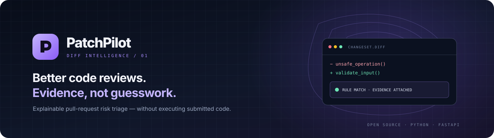

  
  
<strong>Explainable pull-request risk triage, built around evidence and safe defaults.</strong>

  

    
    
    
    
    
  

  
<a href="#quick-start">Get started</a> · <a href="#web-workbench">Web workbench</a> · <a href="docs/architecture.md">Architecture</a> · <a href="ROADMAP.md">Roadmap</a> · <a href="CHANGELOG.md">Changelog</a> · <a href="CONTRIBUTING.md">Contribute</a>

---

## What is PatchPilot?

PatchPilot inspects a unified Git diff and produces **explainable review signals**: changed-file statistics, evidence-backed findings, a heuristic risk score, and test suggestions. It helps reviewers decide where to look first — it does not decide whether a pull request should merge.

The MVP treats a patch as **untrusted text**. It does not clone repositories, execute submitted code, install dependencies from a patch, or call an LLM.

> [!IMPORTANT]
> PatchPilot is an early MVP, not a hosted service or a formal security audit. A low score or an empty findings list does not prove that a change is safe. Review the [limitations](#what-it-does-and-does-not-do) before relying on results.

## Why it exists

- **Evidence first:** findings carry stable rule IDs and supporting evidence.
- **Reproducible:** deterministic rules give repeatable results for the same input.
- **Safe-by-default analysis:** submitted code is parsed as text, not executed.
- **Fits developer workflows:** use the CLI, API, Docker, web workbench, or GitHub Actions.
- **Honest about quality:** a starter benchmark exists, but production precision and recall have not been established.

## Web workbench

The repository includes a responsive, dark-themed workbench for pasting a unified diff, checking the API connection, and reviewing a report.

- Source: [website/](website/)
- The API serves the website at <code>/</code> when the website directory is present, including in the Docker image.
- The workbench sends the diff to the API endpoint configured in the interface. It does not ship with a hard-coded public backend.

To preview the static UI:

~~~bash
python -m http.server 8080 --directory website
~~~

Open <code>http://127.0.0.1:8080</code>. Start the API separately to enable analysis. For cross-origin deployments, set <code>PATCHPILOT_CORS_ORIGINS</code> to a comma-separated list of exact trusted origins. CORS is disabled by default; avoid wildcard origins for public deployments.

## Quick start

Requires Python 3.11 or newer.

~~~bash
python -m venv .venv
source .venv/bin/activate
python -m pip install -e '.[dev]'

ruff check .
ruff format --check .
pytest

uvicorn patchpilot.api:app --reload
~~~

Then open:

- Web workbench: [http://127.0.0.1:8000/](http://127.0.0.1:8000/)
- Interactive API docs: [http://127.0.0.1:8000/docs](http://127.0.0.1:8000/docs)
- Liveness probe: [http://127.0.0.1:8000/health](http://127.0.0.1:8000/health)
- Readiness probe: [http://127.0.0.1:8000/ready](http://127.0.0.1:8000/ready)

## Command-line usage

A complete local example is documented in the [CLI walkthrough](docs/cli-walkthrough.md). The sample diff is synthetic and does not require a hosted backend.

Analyze a saved patch:

~~~bash
patchpilot analyze --diff-file change.diff
~~~

Analyze the current branch relative to <code>origin/main</code>:

~~~bash
git diff origin/main...HEAD | patchpilot analyze --title "Review current branch"
~~~

Get machine-readable JSON:

~~~bash
git diff origin/main...HEAD | patchpilot analyze --json
~~~

The CLI accepts a patch from a file or standard input. Invalid input returns a non-zero exit code.

## API

| Method | Endpoint | Purpose |
| --- | --- | --- |
| <code>GET</code> | <code>/health</code> | Liveness probe |
| <code>GET</code> | <code>/ready</code> | Readiness probe for the stateless MVP |
| <code>POST</code> | <code>/v1/analyze</code> | Validate and analyze a unified diff |
| <code>GET</code> | <code>/docs</code> | Interactive OpenAPI documentation |

Example request body:

~~~json
{
  "title": "Harden request validation",
  "base_ref": "main",
  "head_ref": "feature/validation",
  "diff": "diff --git a/src/example.py b/src/example.py\\n--- a/src/example.py\\n+++ b/src/example.py\\n@@ -1 +1 @@\\n-old()\\n+new()"
}
~~~

Input is limited to 500,000 characters and unknown request fields are rejected. The in-memory rate limiter allows 60 requests per client IP per 60-second window **per process**. It is a basic safety rail, not a shared limiter for multi-worker or public production deployments.

## What it does and does not do

| Capability | Current MVP |
| --- | --- |
| Diff parsing and file statistics | Included |
| Deterministic rule-based findings | Included |
| Heuristic risk score from 0–100 | Included; not a probability |
| Test suggestions | Included |
| CLI, FastAPI and Docker | Included |
| Pull-request summary workflow | Implemented; see workflow and CI status |
| Full language-aware semantic analysis | Not implemented |
| Broad, independently labeled benchmark | Not yet available |
| Repository-wide call graph and impact analysis | Not implemented |
| Autonomous patch generation or execution | Not implemented |
| Hosted public demo | Not currently configured |

Current rules flag patterns such as sensitive-looking paths, dependency manifest changes, broad diffs, risky constructs in added lines (for example shell execution or disabled TLS verification), and production changes without a corresponding test file in the diff.

These signals are heuristics. Path matching can be noisy, tokens can be benign in context, binary contents are not analyzed, and full Git diff grammar coverage remains a work in progress. Do not use the score as a merge gate without independent validation.

## GitHub Actions

- [CI](.github/workflows/ci.yml) runs Ruff lint and formatting checks, tests, Python compilation, and JavaScript syntax validation.
- [Security checks](.github/workflows/security.yml) run a dependency audit and a basic secret-pattern scan.
- [Pull-request analysis](.github/workflows/patchpilot-pr.yml) analyzes a diff from the trusted base revision and publishes a summary. It is designed not to execute pull-request head code.

These workflows improve feedback, but they are not a formal security audit. The secret-pattern scan is intentionally simple and may miss secrets or require review of false positives.

## Benchmark

Run the starter corpus:

~~~bash
python scripts/benchmark.py
~~~

The corpus and script make current behavior reproducible; they do **not** establish production precision or recall. The versioned corpus now includes 12 synthetic rule-regression cases, including benign negative traps and multi-file interactions. It is still deliberately small and hand-authored; no production detection-quality claim should be made from it. Add real Git-generated diffs and independently reviewed labels before publishing precision/recall. See [benchmark methodology](docs/benchmark-methodology.md). See [benchmark methodology](docs/benchmark-methodology.md).

## Security and deployment

- [Threat model](docs/threat-model.md)
- [Security policy and reporting](SECURITY.md)
- [CLI walkthrough](docs/cli-walkthrough.md) — run a synthetic diff locally with no network calls or code execution.
- [Deployment guide](docs/deployment.md)
- [Repository maintenance and release checklist](docs/repository-maintenance.md)
- [Changelog](CHANGELOG.md)
- [Architecture](docs/architecture.md)

A Render Blueprint is provided in <code>render.yaml</code> for a same-origin Docker deployment. Review the service configuration and deployment provider's limits before going public. Do not send secrets or private source code to a deployment unless its data-handling policy is suitable.

## Project layout

~~~text
PatchPilot/
├── .github/workflows/   # CI, security, and PR analysis automation
├── benchmarks/          # Starter benchmark cases
├── docs/                # Architecture, threat model, deployment, methodology
├── scripts/             # Benchmark runner
├── src/patchpilot/      # Parser, rules, analyzer, CLI, API and models
├── tests/               # Unit, API, CLI and parser regression tests
├── website/             # Responsive web workbench
├── Dockerfile
├── render.yaml
└── ROADMAP.md
~~~

## Development

~~~bash
python -m pip install -e '.[dev]'
ruff check .
ruff format --check .
pytest
python -m compileall -q src tests
node --check website/app.js
python scripts/benchmark.py
~~~

Please include regression tests for behavior changes and keep findings deterministic and evidence-backed. See [CONTRIBUTING.md](CONTRIBUTING.md).

## Roadmap

The next meaningful milestones are broader real Git-generated diff fixtures, measured rule quality on a labeled dataset, reliable changed-line annotations, and end-to-end validation of the PR workflow across fork and oversized-diff scenarios.

See the [full roadmap](ROADMAP.md) for scope and release gates.

---

  Built for careful reviewers. Signals, not verdicts.

